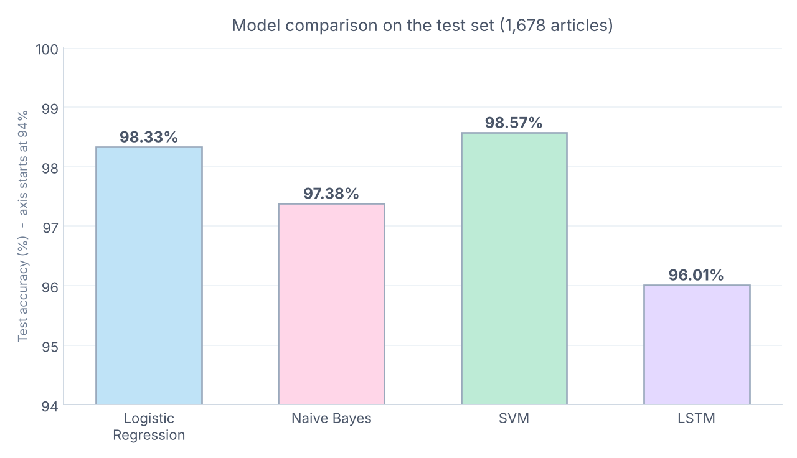
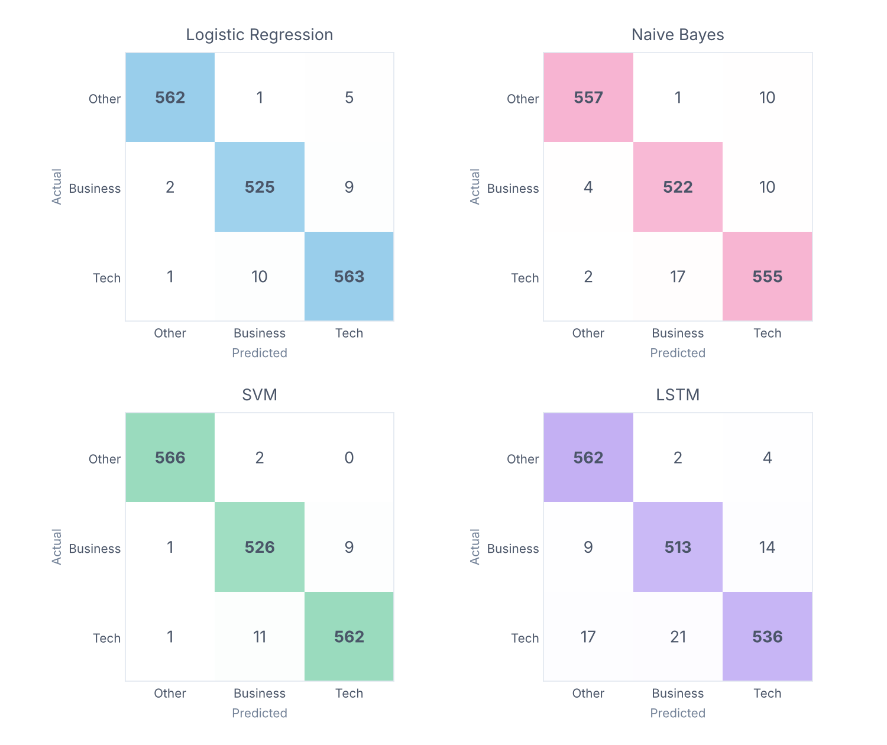

<p align="center">
  
</p>

<p align="center">
  
  
  
  
  
</p>

<p align="center">
  <a href="#english">🌷 English</a> &nbsp;•&nbsp; <a href="#arabic">🌸 العربية</a>
</p>

---

<a id="english"></a>

# 🌷 English

## ✨ Overview

This project classifies **Arabic news articles** into three categories (**Business**, **Technology**, and **Other**) using Natural Language Processing. Four models are trained on the same data and compared: three classic machine learning models on TF-IDF features, and one deep learning model (LSTM).

> 🎓 Course project: DSCE 292 Natural Language Processing, University of Hail (2025-2026)

| 📰 Articles | 🏷️ Classes | 🤖 Models | 🏆 Best accuracy |
|:---:|:---:|:---:|:---:|
| 8,386 | 3 | 4 | **98.57%** (SVM) |

---

## 🌼 Dataset

Arabic news articles with a title, content, and category. After removing rows with missing values, **8,386** articles remain, almost perfectly balanced:

| Category | Articles |
|----------|:--------:|
| Technology (علوم وتكنولوجيا) | 2,800 |
| Other (أخرى) | 2,796 |
| Business (ريادة أعمال) | 2,790 |

> 📁 The data file `processed_data.csv` (about 31 MB) is not included here because it is larger than GitHub's browser upload limit. Place it next to the notebook before running.

---

## 🧁 Pipeline

1. **Clean**: drop the `Link` column and rows with missing values
2. **Combine** `Title` + `Content` into a single `text` column
3. **Arabic preprocessing**: remove numbers and symbols, remove diacritics, normalize letters (أ إ آ → ا، ى → ي، ؤ ئ → ء), remove NLTK Arabic stop words
4. **Split**: 80% train (6,708) / 20% test (1,678), `random_state=42`
5. **Features**: TF-IDF with the 5,000 most important words (ML models), or tokenization + padding to 100 tokens (LSTM)
6. **Train and evaluate** with accuracy, precision, recall, F1-score, and confusion matrices

---

## 🍃 Results

<p align="center">
  
</p>

| Model | Setup | Test accuracy |
|-------|-------|:-------------:|
| 🏆 **SVM** | LinearSVC + TF-IDF | **98.57%** |
| 🔵 Logistic Regression | TF-IDF, `max_iter=1000` | 98.33% |
| 🌷 Naive Bayes | MultinomialNB + TF-IDF | 97.38% |
| 🟣 LSTM | Embedding(64) → LSTM(64) → Dense(3), 5 epochs | 96.01% |

<p align="center">
  
</p>

### 💡 Key findings

- 🏆 **SVM** gave the best results, with a macro-average precision, recall, and F1 of 0.99.
- 📊 The classic models with TF-IDF beat the LSTM on this dataset, and they train in seconds.
- 🔍 Most mistakes are between **Business** and **Technology** (20 of the 24 SVM errors). This makes sense, because news about tech startups and funding overlaps both topics.

---

## 🚀 How to Run

```bash
git clone https://github.com/rawanaltamimii/Arabic-Text-Classification.git
cd Arabic-Text-Classification
pip install -r "requirements 2.txt"
python -c "import nltk; nltk.download('stopwords')"
jupyter notebook "مشروع nlp1.ipynb"
```

The notebook was written in Google Colab. If you run it locally, change the data path in the first cells:

```python
df = pd.read_csv('processed_data.csv', encoding='utf-8', encoding_errors='ignore')
```

---

## 🔭 Limitations and Future Work

- The LSTM was trained for only 5 epochs and its validation accuracy moved between 95% and 98%. Early stopping, more regularization, or pretrained Arabic embeddings could make it steadier.
- Results come from a single train/test split. Cross-validation would give a more reliable estimate.
- Logistic Regression uses a TF-IDF vectorizer fitted before the split, while Naive Bayes and SVM use pipelines that fit it on the training data only. Using pipelines everywhere would make the comparison fully consistent.
- Next step: try transformer models such as BERT for Arabic, larger datasets, and stronger preprocessing (for example stemming).

---

## 👩‍💻 Team

| Member | Contribution |
|--------|--------------|
| **Lujain Alrimali** | Data preprocessing, TF-IDF features, machine learning models, visualization, report writing |
| **Rawan Altamimi** | LSTM implementation, training and evaluation, result analysis, report review |

---

<a id="arabic"></a>

<div dir="rtl">

# 🌸 العربية

## ✨ نظرة عامة

يصنّف هذا المشروع **الأخبار العربية** إلى ثلاث فئات: **ريادة أعمال** و**علوم وتكنولوجيا** و**أخرى**، باستخدام معالجة اللغات الطبيعية. دُرّبت أربعة نماذج على نفس البيانات وقورنت ببعضها: ثلاثة نماذج تعلّم آلي تقليدية على خصائص TF-IDF، ونموذج تعلّم عميق (LSTM).

> 🎓 مشروع مقرر DSCE 292 معالجة اللغات الطبيعية، جامعة حائل (2025-2026)

| 📰 المقالات | 🏷️ الفئات | 🤖 النماذج | 🏆 أعلى دقة |
|:---:|:---:|:---:|:---:|
| 8,386 | 3 | 4 | **98.57%** (SVM) |

---

## 🌼 البيانات

مقالات إخبارية عربية فيها عنوان ومحتوى وتصنيف. بعد حذف الصفوف الناقصة بقي **8,386** مقال، وتوزيع الفئات متوازن تقريبًا:

| الفئة | عدد المقالات |
|-------|:------------:|
| علوم وتكنولوجيا | 2,800 |
| أخرى | 2,796 |
| ريادة أعمال | 2,790 |

> 📁 ملف البيانات `processed_data.csv` (حوالي 31 ميجا) غير مرفوع هنا لأن حجمه أكبر من حد الرفع من متصفح قيت هب. ضعيه بجانب الـ notebook قبل التشغيل.

---

## 🧁 خطوات العمل

1. **التنظيف**: حذف عمود `Link` والصفوف الناقصة
2. **الدمج**: دمج `Title` و`Content` في عمود نص واحد
3. **المعالجة العربية**: حذف الأرقام والرموز، حذف التشكيل، توحيد الحروف (أ إ آ ← ا، ى ← ي، ؤ ئ ← ء)، وحذف كلمات التوقف من NLTK
4. **التقسيم**: 80% تدريب (6,708) و20% اختبار (1,678)، مع `random_state=42`
5. **الخصائص**: TF-IDF بأهم 5,000 كلمة (نماذج التعلّم الآلي)، أو تحويل النص إلى أرقام وتوحيد الطول إلى 100 كلمة (LSTM)
6. **التدريب والتقييم** بمقاييس الدقة والـ precision والـ recall والـ F1 ومصفوفات الخلط

---

## 🍃 النتائج

<p align="center">
  
</p>

| النموذج | الإعداد | دقة الاختبار |
|---------|---------|:------------:|
| 🏆 **SVM** | LinearSVC مع TF-IDF | **98.57%** |
| 🔵 Logistic Regression | TF-IDF، `max_iter=1000` | 98.33% |
| 🌷 Naive Bayes | MultinomialNB مع TF-IDF | 97.38% |
| 🟣 LSTM | Embedding(64) ← LSTM(64) ← Dense(3)، 5 دورات | 96.01% |

<p align="center">
  
</p>
 المشروع، لا تنسي النجمة!</sub>
</p>
